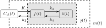

# KinePET

KinePET fits dynamic PET time–activity curves (TACs) with a bounded nonlinear
solver and linear least-squares initialization. The Python API and the standalone
`tcm_fit_tacs` CLI share the same compiled C++ fitting core.

<figure style="margin: 1.5em 0;">
  
  <figcaption style="margin-top: 0.75em; text-align: center;">
    Reversible two-tissue compartment model fitted by KinePET.
    <a href="assets/figures/reversible-2tcm.pdf">Download the figure as PDF</a>.
  </figcaption>
</figure>

The arterial input function `C_A(t)` supplies tracer to two tissue compartments,
`f(t)` and `b(t)`, whose combined activity is `q(t) = f(t) + b(t)`. The measured
PET curve includes both tissue and vascular activity:
`m(t) = (1-vB) * q(t) + vB * C_A(t)`.

KinePET estimates the transfer rates K1, k2, k3, and k4 from the measured TAC and
the supplied arterial input function. `Reversible2TCM` fits the model shown
above; `Irreversible2TCM` fixes k4 to zero, removing the return path from `b(t)`
to `f(t)`. See [Models and Parameters](models.md#scientific-conventions) for
sampling, units, and AIF conventions.

Choose a kinetic model and a blood-fraction setting:

| Python model | Tissue parameters | CLI model name |
| --- | --- | --- |
| `Irreversible2TCM` | K1, k2, k3 | `irr` |
| `Reversible2TCM` | K1, k2, k3, k4 | `rev` |

Both models fit the blood fraction by default. Use `FixedVB(value)` for a known
fraction or `FixedVB(0.0)` to omit the vascular contribution.

For measured arrays `tacs`, `time`, and `aif`:

```python
import kinepet

model = kinepet.Reversible2TCM(vb=kinepet.FittedVB())
fit = kinepet.fit_tacs(tacs, time, aif, model=model, threads=8)

print(fit.K1.shape)
print(fit.status)
```

The TAC layout is `(T, N)`, where `T` is the number of time samples and `N` is the
number of curves. Time is expressed in minutes. The model object specifies the
equations and blood-fraction setting; `fit_tacs` performs the fit and returns
parameters and diagnostics for each curve.

Start with [Getting Started](getting-started.md) for a complete synthetic example.
[Models and Parameters](models.md) explains model selection and scientific
conventions. The [Python API](python-api/index.md) covers fitting, forward
evaluation, and result access. Existing `model="irr"` and `model="rev"` calls
remain supported.
